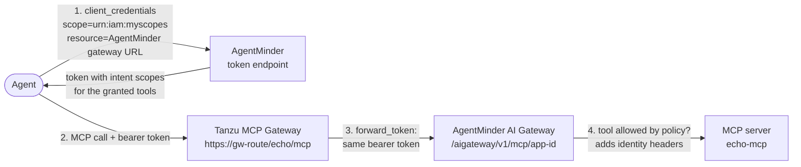

# Tanzu MCP Gateway with AgentMinder

## Overview

This repo shows how to put two gateways in front of an MCP server, so each one does what it's good at:

- The **Tanzu MCP Gateway** (the `mcp-gateway` service of Tanzu Platform's GenAI tile) is the platform's single front door for MCP servers. It's a marketplace service, and it gives one route for every registered server plus gateway metrics. With the Service Publisher tile it also makes MCP servers discoverable in the marketplace.
- **AgentMinder** knows who the agent is and decides which tools that agent may use. Its AI Gateway checks each MCP call against policy, and it hides the tools the agent isn't granted.

Here the Tanzu MCP Gateway forwards the agent's AgentMinder token to the AgentMinder AI Gateway, unchanged. AgentMinder enforces per-tool access and passes the call to the MCP server. The scripts build the whole chain with a small echo MCP server, then test that each layer does its job.

## How it works



1. The agent gets a token from AgentMinder for the AgentMinder gateway URL. The token carries one intent scope per tool the agent's policy grants, for example `urn:iam:agent:intent:whoami`.
2. The agent calls the Tanzu MCP Gateway at `https://<gateway route>/<server name>/mcp`.
3. The Tanzu MCP Gateway has the AgentMinder gateway URL registered as an off-platform server, with `auth.mode: forward_token`. It passes the bearer token on as it is.
4. AgentMinder validates the token, filters `tools/list` to the granted tools, refuses other tool calls, and forwards allowed calls to the MCP server with the same token and extra identity headers.

Details, the sequence diagram and what each layer enforces are in [docs/architecture.md](docs/architecture.md).

## Quick start

Prerequisites:

- Tanzu Platform for Cloud Foundry 11.0 with the GenAI tile 11.0, which offers the `mcp-gateway` service (plan `gateway`). Tested on TPCF 11.0.1.
- An AgentMinder tenant and a tenant admin client (client ID and secret, `client_credentials` grant). Tested with AgentMinder 4.1.1.
- The Tanzu MCP Gateway must trust AgentMinder's TLS certificate. If AgentMinder uses a private CA, add the CA to the Ops Manager Director's trusted certificates and Apply Changes. See [docs/faq.md](docs/faq.md#how-does-the-gateway-trust-a-private-ca).
- `cf` CLI v8 or later, logged in. `curl`, `jq` and `python3` (standard library only).

Steps:

1. Configure:

   ```bash
   cp config.env.example config.env
   $EDITOR config.env
   ```

2. Push the echo MCP server:

   ```bash
   scripts/01-deploy-echo-mcp.sh
   ```

3. Create the AgentMinder resource server, agent client and policy. The policy grants `whoami` and leaves `denyme` ungranted:

   ```bash
   scripts/02-agentminder-setup.py
   ```

4. Create the Tanzu MCP Gateway with the AgentMinder gateway URL as its server:

   ```bash
   scripts/03-create-gateway.sh
   ```

5. Test the chain:

   ```bash
   scripts/04-test.sh
   ```

   Expected result:

   ```
   PASS  1. token carries the whoami intent
   PASS  2. tools/list shows only the granted tool
   PASS  3. whoami works and the server got the agent's token unchanged
   PASS  4. denyme through the Tanzu gateway is refused
   PASS  5. denyme straight at AgentMinder is 403
   PASS  6. whoami with no token is refused
   ```

6. Clean up:

   ```bash
   scripts/99-cleanup.sh
   ```

To put a real MCP server behind the chain, see [docs/faq.md](docs/faq.md#how-do-i-use-my-own-mcp-server).

## Repo structure

```
config.env.example             settings for the scripts; copy to config.env
echo-mcp/                      test MCP server: answers each call with the headers and token claims it got
scripts/01-deploy-echo-mcp.sh  pushes echo-mcp
scripts/02-agentminder-setup.py creates the AgentMinder objects through the admin API
scripts/03-create-gateway.sh   creates or updates the mcp-gateway service instance
scripts/04-test.sh             end-to-end checks
scripts/99-cleanup.sh          deletes everything the scripts made
scripts/lib.sh, mcp.sh         shared helpers (config, curl, a minimal MCP client)
docs/architecture.md           components, call sequence, what each layer enforces
docs/agentminder-api.md        the AgentMinder objects and API calls the setup makes
docs/decisions.md              why the chain is built this way
docs/faq.md                    gotchas and how-tos
docs/validation.md             test results from the reference environment
```
