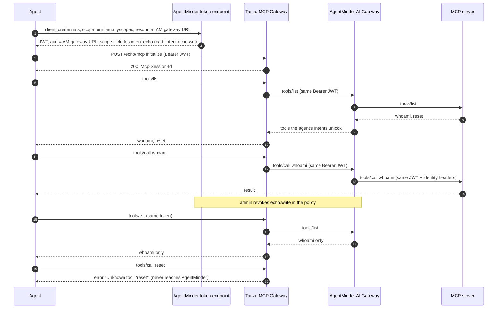

# Architecture

## Components

| Component | What it is | Owns |
|---|---|---|
| Agent | Any MCP client: an app on the platform, a local tool, an agent framework | Its AgentMinder client credentials |
| AgentMinder token endpoint | `<tenant>/oauth2/v1/token` | Agent identity and the intent scopes in each token |
| Tanzu MCP Gateway | A `mcp-gateway` service instance. The broker runs one gateway app per instance, in the `system` org, space `mcp-gateway-<instance guid>` | The public route, the list of registered servers, gateway metrics |
| AgentMinder AI Gateway | `<tenant>/aigateway/v1/mcp/<id>`, one route per AgentMinder resource server | Per-tool authorization, tool-list filtering, identity headers |
| MCP server | `echo-mcp` here. Any MCP server reachable over HTTPS from AgentMinder | The tools |

## Call sequence



## The token

The agent asks for its token with three form fields besides the client credentials:

- `grant_type=client_credentials`
- `scope=urn:iam:myscopes`: AgentMinder puts every intent scope the agent's policies grant into the token. Without it, the token only has the default `urn:iam:m.meclient` scope and AgentMinder grants no tools.
- `resource=<AgentMinder gateway URL>`: the token's audience. AgentMinder's gateway accepts only tokens for its own URL. Using the MCP server's own URL instead fails with "No application found".

Example claims from the test run:

```json
{
  "aud": ["https://agentminder.example.com/default/aigateway/v1/mcp/ZTkw...", "https://agentminder.example.com/default/"],
  "scope": "urn:iam:t.authenticate urn:iam:agent:intent:echo.write urn:iam:m.meclient urn:iam:agent:intent:echo.read"
}
```

The token's lifetime comes from the client's `urn:iam:app:oauthAccessTokenExpirySecs` metadata. The setup script uses 900 seconds, so a token lasts through a demo.

## Intents, bindings and policy

- An **intent** is a permission name, such as `echo.read`. Its scope form is `urn:iam:agent:intent:echo.read`.
- A **tool binding** on the resource server says which intent unlocks a tool. Several tools can share one intent.
- A **policy** says which agents get which intents.

AgentMinder checks two things on every call: the token carries the intent the tool's binding names, and the policy still grants it. So:

| Change | Tokens the agent already has | New tokens |
|---|---|---|
| Revoke an intent in the policy | lose the tools within about 30 seconds | don't carry the intent |
| Grant an intent | don't gain the tools: the intent isn't in them | carry the intent after a few seconds |
| Remove a tool's binding | lose the tool within about 30 seconds, for every agent | same |

Policy conditions match the caller (client, user, group, app), not the tool. Per-tool control goes through intents and bindings.

## What each layer enforces

| Check | Tanzu MCP Gateway | AgentMinder AI Gateway |
|---|---|---|
| A token is present | No. It answers `initialize` itself, with or without a token | Yes. Without a token the call is refused |
| The token is valid for this server | No. `forward_token` passes it on as it is | Yes: issuer, signature, audience |
| The agent may see a tool | Shows what AgentMinder returns | Filters `tools/list` to granted intents |
| The agent may call a tool | Refuses tools that weren't in the list it got ("Unknown tool") | Refuses ungranted tools with 403 |
| Identity reaches the server | Passes the bearer token on | Adds identity headers, keeps the token |

So the Tanzu MCP Gateway isn't a security boundary on its own here. AgentMinder is. The MCP server should also validate the token (see [faq.md](faq.md#how-do-i-use-my-own-mcp-server)), so a caller can't skip both gateways and call it directly.

## What the MCP server receives

The `Authorization` header holds the agent's original token: in the test, the echo server saw the same SHA-256 as the token the agent minted. AgentMinder adds headers that name the caller and the resource server, among them:

- `Appid`, `Appname`: the AgentMinder resource server.
- `Clientid`, `Principalid`, `Principalname`, `Principaltype`: the agent.
- `Accesstokenscopes`: the token's scopes.
- `Issuerurl`, `Issuer-Type`, `Identitysourceid`, `Identitysourcename`, `Identitysourcetype`.
- `Tid`, `Tname`, `X-Tenant-Id`, `X-Tenant-Name`: the AgentMinder tenant.

The Tanzu MCP Gateway adds nothing an MCP server needs.

## Where it runs

The gateway app is a normal CF app, so its instances can land on BOSH Diego cells or on the hosts of a Kubernetes resource segment. The test spread calls over four instances, two on each kind of host, and all of them worked. Kubernetes segment hosts need the `SSL_CERT_FILE` setting in [faq.md](faq.md#why-does-the-gateway-set-ssl_cert_file).

## Discovery

The Tanzu MCP Gateway on its own registers servers but doesn't publish them. A bind of an app to the gateway registers the app as a server, and its binding credentials are empty. The gateway refuses service keys. It has no catalog endpoint and no UI.

Discovery comes from the **Service Publisher** tile. It publishes an MCP server running as a CF app as its own marketplace offering, and registers it in the gateway. Agents then find it in the marketplace and bind to it, and the binding credentials hold the server's URL. Service Publisher publishes CF apps only, so the off-platform AgentMinder URL used here can't be published that way. This repo doesn't cover Service Publisher.
